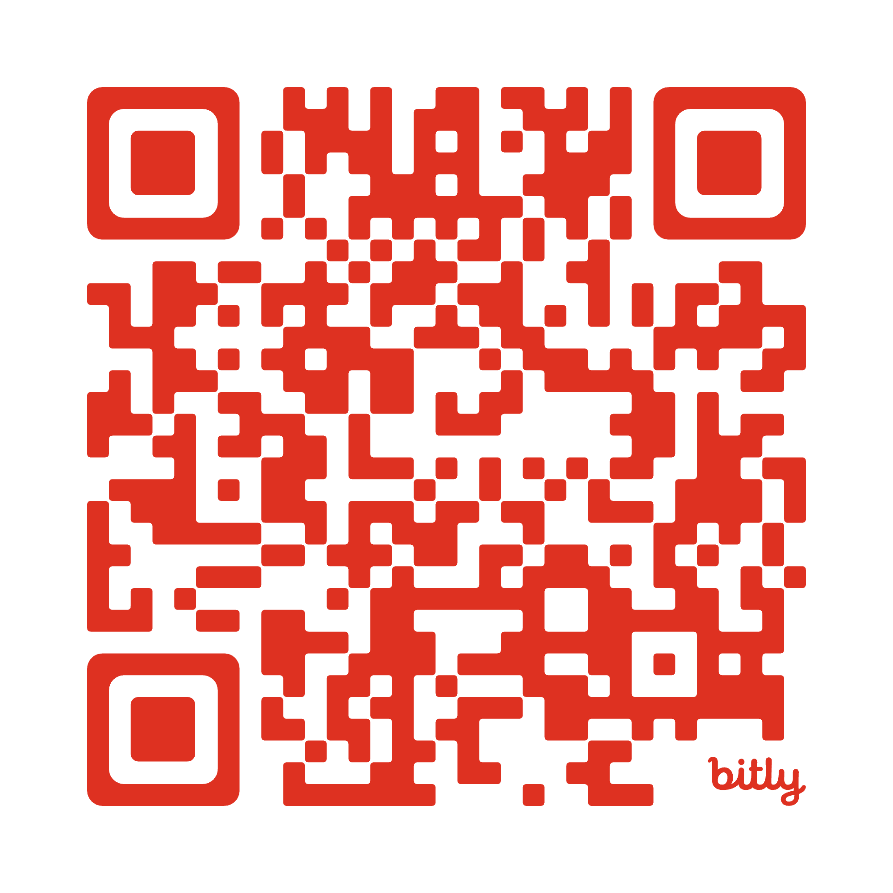

# Server #258
Last Asylum: Plague - Server #258 info

## Rules

**DO NOT** ...
- attack,
- scout,
- rob caravans,
- plunder secret (black) operations

of players that are members of any alliance on the same server (#258).

Exceptions are anyone with a [Kill On Sight Order](kos.md) on against them.

Players without an alliance are open prey!

## Cross-Server Cooperation

- Server #257: DO NOT attack players or rob alliance caravans (the big ones) - individual caravans and secret (black) operations can be looted.

## Kill On Sight orders

This order usually happens because of unresolved server rules violations. Burn these alliances if you see them.

#### Alliances:

- [Ялуу] Ялaxa
- [AEHH] Eternal Horizon

#### Players:
- 

## Active Alliances
- [[Skul] Skull](alliances/skul.md)

## Share repository

via link: https://bit.ly/4i04L9S

via QR Code: 

## Resources
1. [Server Alliances](#alliances)
2. [Game Wiki](https://wiki-last-asylum.com/en)
3. [Game Website](https://www.last-asylum.com/)
